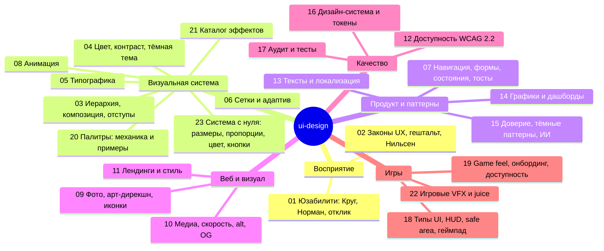

# Карта скилла ui-design

Как пользоваться: найди свою задачу в разделе «Маршруты», прочитай указанные файлы по порядку. Если нужна конкретная тема — смотри «Указатель тем».

## Схема

## Файлы

| Файл | Что внутри | Когда читать |
|---|---|---|
| `SKILL.md` | Процесс, 27 правил, ключевые числа, формат результата | Всегда первым |
| `references/23-design-system-from-scratch.md` | Процесс «бриф → оси характера → параметры», роли размеров шрифта, выбор базы и шкалы, отношение заголовка к тексту, межстрочный и трекинг от размера, веса, выбор гарнитуры, отступы и плотность, пропорции компонентов (высота, радиус от высоты, иконки, рамки, тени), раскладка и пропорции изображений, построение цветовой гаммы за 7 шагов, где ставить кнопки (формы, диалоги по платформам, мобильные, мастера, таблицы, лендинги), `system.json`, два разбора | **Перед любым новым интерфейсом**, до вёрстки; когда «всё выглядит одинаково»; где ставить кнопки |
| `references/01-usability-foundations.md` | Круг, 6 понятий Нормана, пороги отклика 0,1/1/10 с, оптимистичный UI | Любой новый интерфейс; спор «понятно ли это» |
| `references/02-ux-laws-gestalt-heuristics.md` | Фиттс, Хик, Якоб, Миллер/Коуэн, Теслер, Доэрти, гештальт, 10 эвристик Нильсена | Компоновка экрана, меню, выбор; эвристическая оценка |
| `references/03-visual-hierarchy-spacing.md` | CRAP, иерархия весом и цветом, кнопки, шкала отступов, тени, радиусы, тест прищуривания | Любой макет; «выглядит неаккуратно/плоско» |
| `references/04-color-contrast-dark-mode.md` | 60–30–10, WCAG-контраст, семантика цвета, ошибки, OKLCH, тёмная тема, цветовые токены | Палитра, бренд, тёмная тема, проверка контраста |
| `references/20-color-palettes.md` | Почему ИИ-палитры плохие, мягкие палитры, рецепт за 5 шагов, 17 примеров для калибровки, роли токенов, светлота кнопок, гармонии, тёмная тема, игры | Всегда, когда выбираешь цвета; вместе со `scripts/make_palette.py` |
| `references/05-typography.md` | Размеры, шкала, межстрочный, длина строки, трекинг, `clamp()`, кириллица/₸, загрузка шрифтов, цифры | Любой текстовый интерфейс; выбор шрифтов |
| `references/06-layout-grids-responsive.md` | Колонки, гаттеры, брейкпоинты M3/Bootstrap/Tailwind, container queries, safe area, reflow | Адаптив, сетка страницы, планшеты |
| `references/07-patterns-forms-states.md` | Навигация, M3 vs HIG, формы и валидация, 5 состояний экрана, подтверждения, тосты, модалки | Приложения, формы, мобильные экраны |
| `references/08-motion-interaction.md` | Длительности, кривые, токены M3, пружины, производительность, reduced motion, микровзаимодействия | Анимации, переходы, «оживить» интерфейс |
| `references/21-microinteractions-effects.md` | Обязательный слой движения и уровни насыщенности, 10 правил движения, длительности и кривые, каталог ~45 эффектов (формы, кнопки, оверлеи, раскрытие, загрузка, внимание, скролл) с параметрами и fallback | Когда добавляешь анимации, отклик, «живость» |
| `references/09-imagery-art-direction.md` | Арт-дирекшн, текст на фото, скримы, дуотон, блендинг, вырезки, кадрирование, иконки (запрет эмодзи, откуда брать и как рисовать), иллюстрации | Сайты с фото, герои, баннеры, иконки |
| `references/10-web-media-performance.md` | Core Web Vitals, srcset/sizes, LCP, CLS, форматы и бюджеты, плейсхолдеры, видео-фон, OG, фавиконы, alt, лицензии | Вёрстка сайта, медиа, SEO-картинки |
| `references/11-landing-pages-web-style.md` | Структура лендинга, герой, ритм, bento, CTA, доверие, как не выглядеть шаблонно | Лендинги, промо, маркетинговые сайты |
| `references/12-accessibility.md` | WCAG 2.2 (новые критерии), ключевые 2.0/2.1, клавиатура, ARIA, мобильная и когнитивная доступность, EAA | Любой продукт; обязательно для банков и госсервисов |
| `references/13-ux-writing-i18n.md` | Тексты кнопок, ошибки, подтверждения, пустые состояния, расширение текста, плюралы, RTL, форматы | Тексты интерфейса, мультиязычные продукты |
| `references/14-data-viz-dashboards.md` | Выбор графика, честность осей, палитра Okabe–Ito, KPI, дашборды, таблицы | Аналитика, админки, отчёты |
| `references/15-trust-ai-dark-patterns.md` | 18 тёмных паттернов, DSA/FTC, доверие в финансах, ИИ-функции (HAX, PAIR) | Финтех, подписки, оплаты, ИИ-фичи |
| `references/16-design-system-tokens.md` | DTCG 2025.10, 3 уровня токенов, минимальный набор, матрица состояний, кит компонентов | Создание или чистка дизайн-системы |
| `references/17-audit-testing.md` | 12-шаговый аудит, приоритизация находок, 5 пользователей, SUS, first-click, A/B | Ревью готового экрана; перед сдачей работы |
| `references/18-game-ui-hud-platforms.md` | Диегетика, HUD, safe zones, размеры текста XAG, геймпад, глифы, A/B по платформам, мобильные игры, сертификация | Любой игровой UI |
| `references/19-game-feel-onboarding-accessibility.md` | Juice, hitstop, тряска, coyote time, онбординг (Hodent), меню и настройки, GAG, субтитры, укачивание, локализация, F2P | Игровой геймплей-UX, меню, доступность игр |
| `scripts/make_palette.py`, `scripts/check_contrast.py`, `assets/palettes/` | Генератор палитры (`--bright`, `--dark-first`), проверка контраста, 17 примеров | При любом выборе цветов и перед сдачей |
| `scripts/style_tiles.py`, `assets/styles/system.example.json` | Варианты стиля рядом из своих `system.json`, проверки, экспорт `design-system.css` + `DESIGN.md` | Шаг «система до экранов» |
| `scripts/icon.py`, `assets/icons/` | 118 иконок Lucide (ISC): inline-SVG, спрайт, группы | Всегда вместо эмодзи |
| `references/22-game-vfx-juice.md` | Каталог игровых эффектов: тряска, хитстоп, вспышки, цифры урона, HP-призрак, частицы, награды, хаптика, фоточувствительность | Игровой UI и отклик геймплея |
| `assets/effects/` | Библиотека эффектов `fx.*` (CSS + JS) и живая витрина `demo.html` | При любой анимации — подключай, а не пиши заново |
| `references/SOURCES.md` | Первоисточники по разделам | Проверить или процитировать норму |

## Маршруты по задачам

| Задача | Читать по порядку |
|---|---|
| **Лендинг / маркетинговый сайт** | 23 → 03 → 11 → 20 → 09 → 05 → 04 → 06 → 10 → 08 → 21 → 17 |
| **Корпоративный или контентный сайт** | 23 → 03 → 20 → 05 → 06 → 09 → 10 → 13 → 12 → 17 |
| **Мобильное приложение** | 23 → 01 → 02 → 07 → 03 → 05 → 20 → 04 → 08 → 21 → 12 → 17 |
| **Банк / финтех** | 23 → 01 → 07 → 15 → 13 → 20 → 04 → 12 → 05 (цифры) → 17 |
| **Веб-приложение / SaaS / админка** | 23 → 02 → 07 → 06 → 03 → 20 → 14 → 16 → 12 → 17 |
| **Дашборд / аналитика** | 23 → 14 → 03 → 06 → 20 → 04 → 05 → 17 |
| **Формы и онбординг в приложении** | 07 → 13 → 01 → 21 (ошибки, успех) → 12 |
| **Игра: HUD и меню** | 23 → 18 → 19 → 22 → 20 (игровые цвета) → 04 (контраст) → 05 → 08 → 17 |
| **Игра: ощущение управления и удобство** | 19 → 22 → 18 (геймпад) → 08 |
| **Мобильная игра** | 18 (мобильные, safe area) → 19 → 22 → 15 (F2P) |
| **Дизайн-система** | 23 → 16 → 20 → 04 → 05 → 03 → 08 → 12 |
| **Тёмная тема** | 20 → 04 → 09 (изображения) → 16 |
| **ИИ-функция в продукте** | 15 → 07 (состояния) → 13 |
| **Ревью / аудит готового экрана** | 17 → 02 (эвристики) → 12 → нужные тематические |
| **Анимации и эффекты** | 21 → 08 → `assets/effects/demo.html` → 12 (2.2.2, 2.3.x) |
| **«Всё выглядит одинаково», выбор стиля** | 23 → 20 → 05 → `scripts/style_tiles.py` |
| **Где поставить кнопки** | 23 (раздел 5) → 03 (иерархия) → 07 (формы, модалки) |
| **Мультиязычный продукт (каз/рус/англ)** | 13 → 05 (кириллица, ₸) → 06 (логические свойства) |

## Указатель тем

| Тема | Где |
|---|---|
| Создание системы с нуля, варианты стиля | 23 |
| Какой размер шрифта для чего, база, шкала | 23, 05 |
| Пропорции: заголовок/текст, радиус/высота, отступы по уровням | 23, 03 |
| Построение цветовой гаммы | 23 (решения), 20 (механика) |
| Расположение кнопок (формы, диалоги, мобильные) | 23, 03, 07 |
| Эмодзи (запрещены), иконки | 09, `assets/icons/` |
| Подбор палитры, мягкие цвета | 20 |
| Контраст текста | 04, 20, 09 (на фото), 12, 18 (HUD) |
| Цели нажатия / размеры кнопок | 02, 07, 12 (2.5.8), 18 (мобильные игры) |
| Отступы и группировка | 02 (близость), 03 |
| Фокус с клавиатуры / геймпада | 12, 16 (состояния), 18 |
| Ошибки и валидация | 07, 13 |
| Загрузка, скелетоны, пустые состояния | 01, 07, 13 |
| Тосты, уведомления, модалки | 07 |
| Анимация и reduced motion | 08, 21, 10 (видео), 19, 22 (тряска, укачивание) |
| Эффекты: тряска поля, тосты, конфетти, скелетоны | 21, `assets/effects/` |
| Игровые VFX: хитстоп, цифры урона, частицы, награды | 22, 19, `assets/effects/` |
| Фото, текст на фото, блендинг | 09 |
| Производительность картинок, LCP, CLS | 10 |
| Сетки и брейкпоинты | 06, 11 |
| Тёмная тема | 04, 20 |
| Токены | 04, 16 |
| Локализация, длина текста | 13, 19 |
| Графики и таблицы | 14 |
| Тёмные паттерны | 15, 19 (F2P) |
| Субтитры, вспышки, укачивание | 19, 12 (2.3.1) |
| Безопасные зоны (ТВ, вырезы) | 06, 18 |
| Платформы: M3, HIG, консоли | 07, 18 |
| Юзабилити-тесты | 17 |
